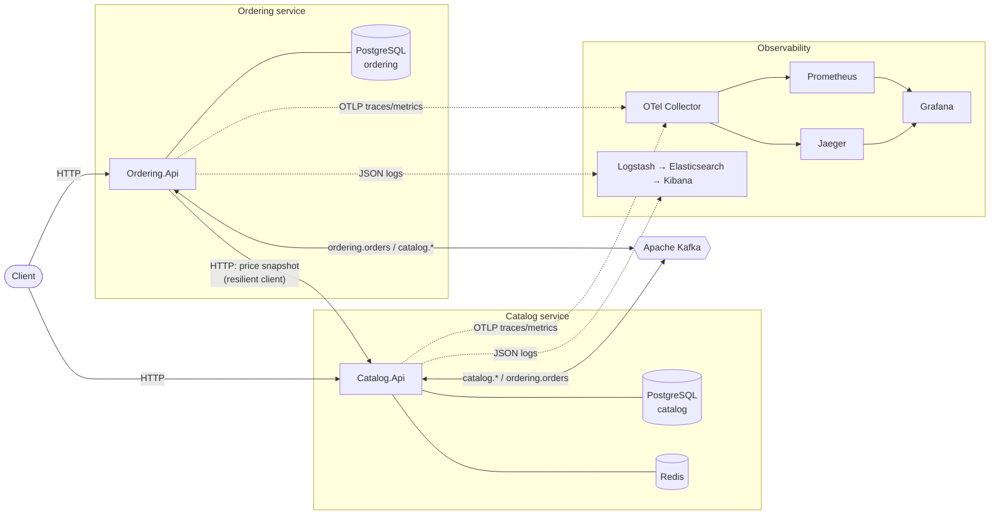
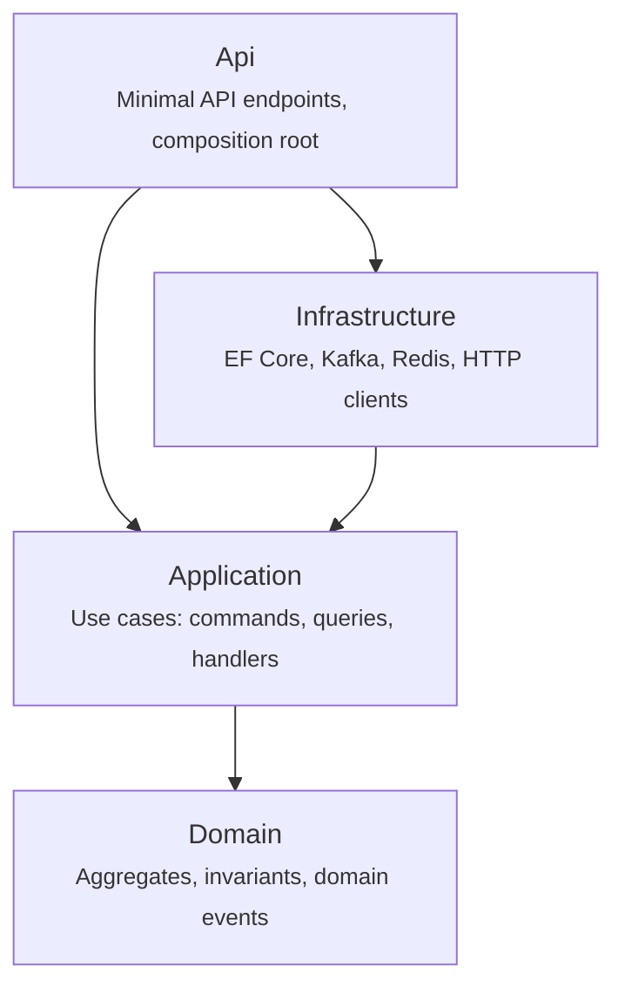
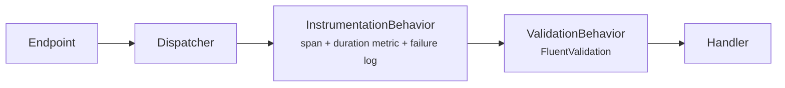
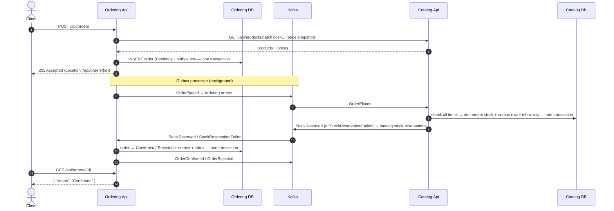
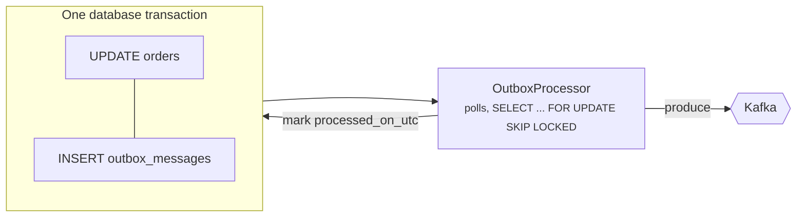

# Distributed .NET Microservices Reference Architecture

A production-grade reference implementation of a distributed system on **.NET 8**, showing how
**Clean Architecture**, **CQRS** and **event-driven integration** fit together in real code, with the
reliability patterns real systems need (transactional outbox, idempotent consumers, retries,
dead-lettering, optimistic concurrency, cache-aside, resilient HTTP) and **observability built in
from day one** (OpenTelemetry, structured logging, metrics).

> The business domain is deliberately small — a product catalog and an ordering service — so the
> focus stays on the architecture, not on business rules.

---

## Table of contents

1. [Tech stack](#tech-stack)
2. [The domain in one minute](#the-domain-in-one-minute)
3. [Architecture overview](#architecture-overview)
4. [Repository layout](#repository-layout)
5. [Core concepts, and where to find them in the code](#core-concepts-and-where-to-find-them-in-the-code)
   - [Clean Architecture](#1-clean-architecture)
   - [Domain model (DDD tactical patterns)](#2-domain-model-ddd-tactical-patterns)
   - [Result pattern: errors as values](#3-result-pattern-errors-as-values)
   - [CQRS and the in-house dispatcher](#4-cqrs-and-the-in-house-dispatcher)
   - [Domain events vs. integration events](#5-domain-events-vs-integration-events)
   - [Event-driven integration with Kafka](#6-event-driven-integration-with-kafka)
   - [The order saga (choreography)](#7-the-order-saga-choreography)
   - [Transactional outbox](#8-transactional-outbox)
   - [Idempotent consumer (inbox), retries and dead-letter topics](#9-idempotent-consumer-inbox-retries-and-dead-letter-topics)
   - [Optimistic concurrency](#10-optimistic-concurrency)
   - [Cache-aside with Redis](#11-cache-aside-with-redis)
   - [Resilient synchronous calls](#12-resilient-synchronous-calls)
   - [Observability](#13-observability)
   - [Health checks](#14-health-checks)
   - [Error handling at the edge (RFC 7807)](#15-error-handling-at-the-edge-rfc-7807)
6. [API reference](#api-reference)
7. [Getting started](#getting-started)
8. [Configuration](#configuration)
9. [Testing strategy](#testing-strategy)
10. [Project status and roadmap](#project-status-and-roadmap)
11. [Architecture Decision Records](#architecture-decision-records)
12. [Design trade-offs](#design-trade-offs)
13. [License](#license)

---

## Tech stack

| Concern | Technology |
| --- | --- |
| Runtime and web | .NET 8, ASP.NET Core Minimal APIs |
| Persistence | PostgreSQL 16, Entity Framework Core 8 (Npgsql, snake_case naming) |
| Messaging | Apache Kafka (Confluent.Kafka client) |
| Caching | Redis (`IDistributedCache` via StackExchange.Redis) |
| Validation | FluentValidation |
| Resilience | Microsoft.Extensions.Http.Resilience (Polly v8) |
| Tracing and metrics | OpenTelemetry (OTLP exporter) → collector → Jaeger / Prometheus → Grafana |
| Logging | Serilog (structured JSON) → Logstash → Elasticsearch → Kibana (ELK) |
| API docs | Swagger / OpenAPI (Swashbuckle) |
| Testing | xUnit, NSubstitute, NetArchTest, Testcontainers, `WebApplicationFactory` |
| Delivery | Docker, Kubernetes (AKS), GitHub Actions |

Package versions are pinned centrally in [`Directory.Packages.props`](Directory.Packages.props)
(NuGet Central Package Management), and the SDK in [`global.json`](global.json).

---

## The domain in one minute

Two bounded contexts, each owned by one service with its own database:

- **Catalog** owns products: name, price and **available stock**.
- **Ordering** owns orders: customer, items, prices and **status** (`Pending → Confirmed | Rejected`).

Placing an order is a business process spanning both services. Ordering cannot decrement Catalog's
stock directly (it doesn't own that data), and there is no distributed transaction. Instead, the
services cooperate through **events**:

1. A customer places an order → Ordering stores it as **Pending** and publishes `OrderPlaced`.
2. Catalog reacts by trying to reserve stock for every item, **all or nothing**, then publishes
   either `StockReserved` or `StockReservationFailed`.
3. Ordering reacts by moving the order to **Confirmed** or **Rejected**.

This process is called a **saga**. It shows almost every pattern in this repository.

---

## Architecture overview



Key properties:

- **Database per service.** Each service owns its schema; no service reads another's tables.
- **Asynchronous by default.** State changes that cross a service boundary travel as events.
  The single synchronous call (Ordering → Catalog, to *price* an order) is a read, protected
  by retries, timeouts and a circuit breaker.
- **Shared code is infrastructure only.** The `BuildingBlocks` projects hold technical
  plumbing. No business logic is shared, and services couple only through small `*.Contracts`
  assemblies that contain nothing but event records.

---

## Repository layout

```text
.
├── src/
│   ├── BuildingBlocks/                    # Technical plumbing shared by all services
│   │   ├── BuildingBlocks.Domain/         # Entity, AggregateRoot, DomainEvent, Result, Error
│   │   ├── BuildingBlocks.Application/    # CQRS dispatcher, pipeline behaviors, IUnitOfWork
│   │   ├── BuildingBlocks.Messaging/      # IntegrationEvent, IOutbox, handler registry (broker-agnostic)
│   │   ├── BuildingBlocks.Infrastructure/ # EF Core base context, outbox/inbox, Kafka producer/consumer
│   │   └── BuildingBlocks.Web/            # Service defaults: Serilog, OpenTelemetry, health, ProblemDetails
│   └── Services/
│       ├── Catalog/
│       │   ├── Catalog.Domain/            # Product aggregate, repository interface, errors
│       │   ├── Catalog.Contracts/         # Public events: StockReserved, StockReservationFailed, ...
│       │   ├── Catalog.Application/       # Commands, queries, handlers, validators
│       │   ├── Catalog.Infrastructure/    # EF Core, migrations, Redis cache, DI wiring
│       │   └── Catalog.Api/               # Minimal API endpoints, Program.cs, Dockerfile
│       └── Ordering/
│           ├── Ordering.Domain/           # Order aggregate (state machine), OrderItem
│           ├── Ordering.Contracts/        # Public events: OrderPlaced, OrderConfirmed, ...
│           ├── Ordering.Application/      # PlaceOrder, Confirm/Reject, saga event handlers
│           ├── Ordering.Infrastructure/   # EF Core, migrations, resilient Catalog HTTP client
│           └── Ordering.Api/              # Minimal API endpoints, Program.cs, Dockerfile
├── tests/
│   ├── BuildingBlocks.UnitTests/          # Dispatcher pipeline, Result semantics
│   ├── Catalog.UnitTests/                 # Product invariants, stock reservation, cache-aside
│   ├── Ordering.UnitTests/                # Order state machine, PlaceOrder handler
│   ├── ArchitectureTests/                 # Layer dependency rules enforced with NetArchTest
│   ├── Catalog.IntegrationTests/          # Real PostgreSQL + Redis + Kafka via Testcontainers
│   ├── Ordering.IntegrationTests/         # Real PostgreSQL + Kafka via Testcontainers
│   └── Testing.Shared/                    # Kafka test client, polling helpers
├── deploy/
│   ├── docker/postgres/                   # Database-per-service init script
│   ├── observability/                     # OTel Collector, Prometheus, Grafana (dashboards as code), Logstash
│   └── k8s/                               # Kustomize: base + overlays (local, aks)
├── docs/adr/                              # Architecture Decision Records
├── .github/                               # CI, CD to AKS, Dependabot
├── docker-compose.yml                     # Full local stack: services + infrastructure + observability
├── Directory.Build.props                  # Common compiler settings (nullable, warnings as errors, ...)
├── Directory.Packages.props               # Central package versions
└── global.json                            # Pinned .NET SDK
```

---

## Core concepts, and where to find them in the code

### 1. Clean Architecture

Each service is split into concentric layers. **Source code dependencies point inwards only.**



| Layer | Responsibility | May depend on |
| --- | --- | --- |
| **Domain** | Business rules and invariants (e.g. *stock can never be negative*). Pure C#, no frameworks. | `BuildingBlocks.Domain` only |
| **Application** | Orchestrates use cases: loads aggregates, calls domain methods, commits. Defines *ports* (interfaces) such as `IProductRepository`, `ICatalogClient` and `IProductCache`. | Domain, contracts, abstractions |
| **Infrastructure** | Implements the ports: EF Core repositories, Redis cache, HTTP clients, Kafka. | Application |
| **Api** | HTTP endpoints and dependency injection wiring (the *composition root*). | Everything |

Why it matters: business rules can be unit-tested in milliseconds without a database, and
infrastructure can be swapped (e.g. Kafka for Azure Service Bus) without touching use cases.

**These rules are enforced, not just documented.**
[`tests/ArchitectureTests/LayerDependencyTests.cs`](tests/ArchitectureTests/LayerDependencyTests.cs)
fails the build if, for example, the domain references EF Core, the application layer references
infrastructure, or one service references another service's internals instead of its contracts.

### 2. Domain model (DDD tactical patterns)

- **Entity** ([`Entity.cs`](src/BuildingBlocks/BuildingBlocks.Domain/Entity.cs)): an object with
  identity; equality is based on `Id`.
- **Aggregate root** ([`AggregateRoot.cs`](src/BuildingBlocks/BuildingBlocks.Domain/AggregateRoot.cs)):
  the consistency boundary. All changes go through its methods, which protect its invariants. Only
  aggregate roots are loaded and saved through repositories.
- **Encapsulation**: setters are private. A `Product` cannot be put into an invalid state from the
  outside. `RemoveStock(5)` either succeeds or returns an error.

Examples:

- [`Product`](src/Services/Catalog/Catalog.Domain/Products/Product.cs): `Create`, `ChangePrice`,
  `RemoveStock` and `Restock` guard price and stock invariants.
- [`Order`](src/Services/Ordering/Ordering.Domain/Orders/Order.cs): a small **state machine**
  (`Pending → Confirmed | Rejected`). Transitions are **idempotent**: confirming an already
  confirmed order is a no-op, which makes redelivered messages harmless.

### 3. Result pattern: errors as values

Expected failures ("product not found", "insufficient stock", "duplicate SKU") are not
exceptional, so they are **returned**, not thrown:

```csharp
public Result RemoveStock(int quantity)
{
    if (!HasStock(quantity))
        return ProductErrors.InsufficientStock(Id, quantity, AvailableStock); // implicit Error → Result

    AvailableStock -= quantity;
    return Result.Success();
}
```

- [`Result` / `Result<T>`](src/BuildingBlocks/BuildingBlocks.Domain/Result.cs) and
  [`Error`](src/BuildingBlocks/BuildingBlocks.Domain/Error.cs). Each `Error` has a `Code`, a
  `Description` and an `ErrorType` (`Validation`, `NotFound`, `Conflict`, `Unavailable`, `Failure`).
- At the HTTP edge, [`ResultHttpExtensions`](src/BuildingBlocks/BuildingBlocks.Web/ResultHttpExtensions.cs)
  maps the `ErrorType` to a status code (`NotFound → 404`, `Conflict → 409`, `Unavailable → 503`, ...).
- Exceptions are reserved for bugs and infrastructure failures.

### 4. CQRS and the in-house dispatcher

**CQRS (Command Query Responsibility Segregation)** separates operations that *change* state
(**commands**) from operations that *read* it (**queries**):

| | Commands | Queries |
| --- | --- | --- |
| Purpose | Change state, enforce invariants | Return data |
| Path | Repository → aggregate → `SaveChanges` | Read service → `AsNoTracking()` projection straight into a DTO |
| Example | `PlaceOrderCommand`, `ReserveStockCommand` | `GetProductByIdQuery`, `ListProductsQuery` |

The write side loads full aggregates to protect invariants. The read side skips the domain
model entirely and projects only the columns it needs. In Catalog, the read side is backed by
Redis as well. Each side can be optimized independently.

**The dispatcher.** Endpoints don't call handlers directly. They send a message through
[`IDispatcher`](src/BuildingBlocks/BuildingBlocks.Application/Cqrs/Abstractions.cs), which resolves
the single handler and wraps it in **pipeline behaviors** (cross-cutting concerns applied to every
use case):



- [`InstrumentationBehavior`](src/BuildingBlocks/BuildingBlocks.Application/Behaviors/InstrumentationBehavior.cs)
  opens an OpenTelemetry span per command/query and records the `app.request.duration` histogram,
  so every use case shows up in traces and dashboards for free.
- [`ValidationBehavior`](src/BuildingBlocks/BuildingBlocks.Application/Behaviors/ValidationBehavior.cs)
  runs all validators before the handler executes.

The [`Dispatcher`](src/BuildingBlocks/BuildingBlocks.Application/Cqrs/Dispatcher.cs) is around 60
lines and has no third-party dependency. MediatR became commercially licensed in 2025, and a
reference architecture should show that the mediator pattern is simple enough to own. Handlers,
domain event handlers and validators are discovered by assembly scanning in
[`AddApplicationCore`](src/BuildingBlocks/BuildingBlocks.Application/ApplicationServiceCollectionExtensions.cs).

Each use case lives in **one file** (command + validator + handler), e.g.
[`PlaceOrder.cs`](src/Services/Ordering/Ordering.Application/Orders/PlaceOrder.cs), so a feature
is read top to bottom in one place.

### 5. Domain events vs. integration events

The two event types are distinct, and keeping them separate is deliberate:

| | Domain event | Integration event |
| --- | --- | --- |
| Scope | Inside one service (in-process) | Between services (over Kafka) |
| Example | `OrderPlacedDomainEvent(Order)` | `OrderPlacedIntegrationEvent(OrderId, CustomerId, Items, Total)` |
| Coupling | Can reference domain objects freely | A **public, versioned contract** with primitives only |
| Delivery | Synchronously, before the transaction commits | Asynchronously, at-least-once, via the outbox |

How they connect:

1. An aggregate **raises** a domain event (`order.Raise(new OrderPlacedDomainEvent(order))`).
2. Before committing, [`AppDbContextBase.SaveChangesAsync`](src/BuildingBlocks/BuildingBlocks.Infrastructure/Persistence/AppDbContextBase.cs)
   **dispatches** the pending domain events to their handlers.
3. A domain event handler decides what becomes public. It translates the event into an
   integration event and writes it to the **outbox**
   ([`OrderDomainEventHandlers.cs`](src/Services/Ordering/Ordering.Application/Orders/OrderDomainEventHandlers.cs)).
4. Everything (the order, its items and the outbox row) is committed in **one transaction**.

### 6. Event-driven integration with Kafka

- **Contracts.** Each service publishes its events in a tiny `*.Contracts` assembly
  ([`OrderingIntegrationEvents.cs`](src/Services/Ordering/Ordering.Contracts/OrderingIntegrationEvents.cs),
  [`CatalogIntegrationEvents.cs`](src/Services/Catalog/Catalog.Contracts/CatalogIntegrationEvents.cs)).
  Consumers reference the contracts only, never the producer's domain.
- **Topics per aggregate stream**, with several event types per topic:

  | Topic | Producer | Events | Message key |
  | --- | --- | --- | --- |
  | `ordering.orders` | Ordering | `OrderPlaced`, `OrderConfirmed`, `OrderRejected` | order id |
  | `catalog.stock-reservations` | Catalog | `StockReserved`, `StockReservationFailed` | order id |
  | `catalog.products` | Catalog | `ProductPriceChanged` | product id |

- **Message key = aggregate id.** Kafka guarantees ordering *within a partition*, and the key
  decides the partition. So all events of one order arrive in order, while different orders are
  processed in parallel.
- **Headers** carry `event-type` (used to route to the right handler), `message-id` (used for
  de-duplication) and W3C `traceparent` (used for distributed tracing).
- **Subscribing** is declarative:
  ```csharp
  services.AddIntegrationEventHandler<OrderPlacedIntegrationEvent, OrderPlacedIntegrationEventHandler>(OrderingTopics.Orders);
  ```
  The [`IntegrationEventRegistry`](src/BuildingBlocks/BuildingBlocks.Messaging/IntegrationEventRegistry.cs)
  derives the topics to subscribe to from these registrations. Event types a service doesn't
  handle are skipped.
- The producer is **idempotent** (`enable.idempotence=true`, `acks=all`), so broker-level retries
  don't create duplicates.

### 7. The order saga (choreography)

A **saga** is a sequence of local transactions, each in one service, linked by events. There is
no distributed transaction (2PC). When a step fails, the process ends in a consistent
compensating state: here, a *Rejected* order with nothing reserved.

This implementation uses **choreography**: there is no central coordinator, and each service
reacts to the events it cares about.



Points to notice:

- The client receives **`202 Accepted`**, not `201 Created`. The order exists, but its outcome is
  decided asynchronously. Clients poll `GET /api/orders/{id}`, or would subscribe to a
  notification in a richer system.
- Catalog **checks every item before changing any of them**
  ([`ReserveStock.cs`](src/Services/Catalog/Catalog.Application/Stock/ReserveStock.cs)), so a
  rejected order never leaves partial reservations behind.
- Prices are snapshotted at placement time. Later price changes don't alter existing orders.

### 8. Transactional outbox

**The problem (dual write).** A handler must both commit to the database *and* publish to Kafka.
Those are two systems with no shared transaction:

- Commit then publish: if the process crashes between the two, the event is **lost**.
- Publish then commit: if the commit fails, consumers react to something that **never happened**.

**The solution.** Write the event into an `outbox_messages` table *in the same transaction* as the
business change. A background worker relays committed rows to Kafka afterwards.



Implementation details ([`OutboxProcessor.cs`](src/BuildingBlocks/BuildingBlocks.Infrastructure/Outbox/OutboxProcessor.cs)):

- Rows are claimed with `FOR UPDATE SKIP LOCKED`, so **several replicas** can run the processor
  without publishing the same row in parallel.
- Processing stops at the first failure in a batch to **preserve ordering**. The row's `attempts`
  and `last_error` are recorded, and it is retried on the next tick.
- A **partial index** (`WHERE processed_on_utc IS NULL`) keeps polling cheap as the table grows.
- The `traceparent` of the original HTTP request is stored with the row, so the trace continues
  across the asynchronous hop.
- The guarantee is **at-least-once**: a crash after publishing but before marking the row means it
  is published again. That is why consumers must be idempotent.

### 9. Idempotent consumer (inbox), retries and dead-letter topics

[`KafkaConsumerService`](src/BuildingBlocks/BuildingBlocks.Infrastructure/Kafka/KafkaConsumerService.cs)
turns at-least-once delivery into **effectively-once processing**:

1. Read a message, extract `event-type`, `message-id` and the trace context.
2. Open a DB transaction and check `inbox_messages` for `(message_id, consumer_group)`.
   If found, it's a duplicate: skip it.
3. Run the handler, insert the inbox row, and **commit both together**.
4. Only then **commit the Kafka offset** (auto-commit is disabled).

Failure handling:

- **Transient errors** (database blip, concurrency conflict) are retried in-process with
  exponential backoff (`Kafka:MaxProcessingAttempts`, default 3).
- **Poison messages** (e.g. an invalid payload) are moved to `{topic}.dlq` with
  `dead-letter-reason` and `original-topic` headers, so one bad message never blocks a partition.
- The integration test `DuplicateOrderPlacedEvent_IsProcessedOnlyOnce` publishes the same message
  twice and asserts stock is decremented once.

### 10. Optimistic concurrency

Two orders for the same product can be processed at the same time. Both `Product` and `Order`
use PostgreSQL's system column **`xmin` as a row version**
([`ProductConfiguration.cs`](src/Services/Catalog/Catalog.Infrastructure/Persistence/ProductConfiguration.cs)).
If a row changed after it was read, `SaveChanges` throws `DbUpdateConcurrencyException`:

- inside a Kafka consumer, the message is retried with fresh data;
- over HTTP, the client receives **409 Conflict**.

A database `CHECK (available_stock >= 0)` constraint is a last line of defense behind the domain
rule.

### 11. Cache-aside with Redis

`GET /api/products/{id}` uses the **cache-aside** pattern
([`ProductQueries.cs`](src/Services/Catalog/Catalog.Application/Products/ProductQueries.cs),
[`RedisProductCache.cs`](src/Services/Catalog/Catalog.Infrastructure/Caching/RedisProductCache.cs)):

1. Look in Redis. On a **hit**, return the cached value.
2. On a **miss**, read PostgreSQL, store the result with a TTL (default 10 min), then return it.
3. Commands that change a product (price change, restock, stock reservation) **invalidate** its key.

Design choices:

- **Fail open.** If Redis is down, reads fall back to PostgreSQL and a warning is logged. A cache
  outage costs latency, never availability.
- The **TTL bounds staleness** if an invalidation is ever lost.
- Hits, misses and errors are counted (`catalog.cache.requests{result=...}`), so the hit ratio
  can be charted.
- Redis commands appear as spans in traces (OpenTelemetry Redis instrumentation).

### 12. Resilient synchronous calls

Ordering calls Catalog over HTTP to price an order
([`CatalogHttpClient.cs`](src/Services/Ordering/Ordering.Infrastructure/Http/CatalogHttpClient.cs)).
The typed `HttpClient` uses `AddStandardResilienceHandler()`, which provides retries with jittered
backoff, per-attempt and total timeouts, a circuit breaker and a rate limiter. When all of these
are exhausted, the client returns `OrderErrors.CatalogUnavailable`, and the API responds
**503 Service Unavailable** instead of a raw 500.

### 13. Observability

Every service gets the same telemetry by calling one line, `builder.AddServiceDefaults(...)`
([`ServiceDefaultsExtensions.cs`](src/BuildingBlocks/BuildingBlocks.Web/ServiceDefaultsExtensions.cs)).

**The three signals:**

| Signal | Produced by | Shipped to | Used for |
| --- | --- | --- | --- |
| **Traces** | OpenTelemetry: ASP.NET Core, HttpClient, Npgsql, Redis, plus custom spans for commands/queries and Kafka publish/process | OTLP → Collector → **Jaeger** | Following one request across services and the broker |
| **Metrics** | OpenTelemetry: HTTP, runtime (GC, thread pool), plus custom business metrics | OTLP → Collector → **Prometheus** → **Grafana** | Dashboards and alerts (rate, errors, latency) |
| **Logs** | Serilog, structured JSON | HTTP → **Logstash** → **Elasticsearch** → **Kibana** | Searching events and diagnosing errors |

**Distributed tracing across Kafka.** HTTP propagates trace context automatically. Kafka does
not, so the producer **injects** the W3C `traceparent` into message headers and the consumer
**extracts** it and starts a `CONSUMER` span with that parent. The saga therefore shows up as a
**single trace**: `POST /api/orders` → `PlaceOrderCommand` → SQL INSERT → `ordering.orders publish`
→ (Catalog) `ordering.orders process` → `ReserveStockCommand` → ... → (Ordering) `ConfirmOrderCommand`.

**Log ↔ trace correlation.** Logs are written in compact JSON with `@tr` (trace id) and `@sp`
(span id). From a Kibana log line you can jump to the exact trace in Jaeger, and back.

**Custom metrics:**

| Metric (Prometheus name) | Meaning |
| --- | --- |
| `app_request_duration_milliseconds` | Command/query duration by `app_request_name` and outcome |
| `ordering_orders_placed_total` / `_confirmed_total` / `_rejected_total` | Business throughput of the saga |
| `messaging_publish_messages_total` | Events relayed by the outbox, per topic |
| `messaging_process_messages_total` | Events handled by consumers, per topic and type |
| `messaging_dead_letter_messages_total` | Poison messages: should be zero, so alert on it |
| `catalog_cache_requests_total{result}` | Cache hits, misses and errors |

Exporters are enabled only when `OTEL_EXPORTER_OTLP_ENDPOINT` / `Logstash:Url` are configured,
so tests and ad-hoc runs need no telemetry backend. Health-check requests are excluded from
traces, and so are the log shipper's own HTTP calls.

### 14. Health checks

| Endpoint | Checks | Kubernetes probe |
| --- | --- | --- |
| `/health/live` | Only that the process responds | **liveness**: restart the pod if it fails |
| `/health/ready` | PostgreSQL (and Redis for Catalog) | **readiness**: stop routing traffic while dependencies are down |

Keeping them separate prevents a database outage from triggering a restart storm. The pod stays
alive but is taken out of the load balancer.

### 15. Error handling at the edge (RFC 7807)

All errors are returned as `application/problem+json` (**Problem Details**), always including a
`traceId` so a support ticket can be matched to its trace:

```json
{
  "type": "https://tools.ietf.org/html/rfc9110#section-15.5.10",
  "title": "Products.DuplicateSku",
  "status": 409,
  "detail": "A product with SKU 'KB-01' already exists.",
  "instance": "/api/products",
  "traceId": "4bf92f3577b34da6a3ce929d0e0e4736"
}
```

- Business errors (`Result`) → mapped by `ResultHttpExtensions`.
- `ValidationException` → **400** with a per-field `errors` dictionary.
- `DbUpdateConcurrencyException` → **409**.
- Anything else → **500**, logged with the full exception; details are not leaked to the client.

See [`GlobalExceptionHandler.cs`](src/BuildingBlocks/BuildingBlocks.Web/GlobalExceptionHandler.cs).

---

## API reference

Swagger UI is available at `/swagger` in Development.

### Catalog (`http://localhost:5101`)

| Method | Route | Description | Success |
| --- | --- | --- | --- |
| `GET` | `/api/products?page=1&pageSize=20` | List products (ordered by name) | 200 |
| `GET` | `/api/products/{id}` | Get one product (cache-aside) | 200 / 404 |
| `GET` | `/api/products/batch?ids={id}&ids={id}` | Get up to 100 products at once | 200 |
| `POST` | `/api/products` | Create a product | 201 / 400 / 409 |
| `PUT` | `/api/products/{id}/price` | Change the price (publishes `ProductPriceChanged`) | 204 / 404 |
| `POST` | `/api/products/{id}/restock` | Add stock | 204 / 404 |

### Ordering (`http://localhost:5102`)

| Method | Route | Description | Success |
| --- | --- | --- | --- |
| `POST` | `/api/orders` | Place an order (starts the saga) | 202 / 400 / 404 / 503 |
| `GET` | `/api/orders/{id}` | Get an order and its current status | 200 / 404 |

### Walkthrough

```http
### 1. Create a product with 5 units in stock
POST http://localhost:5101/api/products
Content-Type: application/json

{ "sku": "KB-01", "name": "Mechanical keyboard", "description": "Hot-swappable", "price": 99.90, "initialStock": 5 }

### 2. Place an order for 2 units (use the id returned in step 1)
POST http://localhost:5102/api/orders
Content-Type: application/json

{ "customerId": "3fa85f64-5717-4562-b3fc-2c963f66afa6", "items": [ { "productId": "<product-id>", "quantity": 2 } ] }

### 3. Moments later: the order is Confirmed and the stock is 3
GET http://localhost:5102/api/orders/<order-id>
GET http://localhost:5101/api/products/<product-id>

### 4. Order 10 units: the order ends up Rejected with a reason, and stock is unchanged
```

---

## Getting started

### Prerequisites

- [.NET SDK 8.0.403+](https://dotnet.microsoft.com/download/dotnet/8.0) (pinned in `global.json`)
- [Docker](https://www.docker.com/) to run the integration tests and the infrastructure (PostgreSQL, Kafka, Redis)

### Build and run the fast tests (no Docker needed)

```bash
dotnet build ReferenceArchitecture.sln
```

```bash
dotnet test ReferenceArchitecture.sln --filter "Category!=Integration"
```

### Run the integration tests (Docker required)

Testcontainers starts disposable PostgreSQL, Redis and Kafka containers automatically:

```bash
dotnet test ReferenceArchitecture.sln --filter "Category=Integration"
```

### Run the whole stack with Docker Compose

[`docker-compose.yml`](docker-compose.yml) starts both services, the infrastructure and the full
observability stack (give Docker about 6 GB of RAM):

```bash
docker compose up -d --build
```

| What | URL |
| --- | --- |
| Catalog API (Swagger) | http://localhost:5101/swagger |
| Ordering API (Swagger) | http://localhost:5102/swagger |
| Grafana: *Services Overview* dashboard | http://localhost:3000 |
| Jaeger: distributed traces | http://localhost:16686 |
| Prometheus | http://localhost:9090 |
| Kibana: logs (create a data view for `dotnet-logs-*`) | http://localhost:5601 |
| Kafka UI: topics, messages, consumer lag | http://localhost:8085 |

Configuration for the observability tools lives in [`deploy/observability`](deploy/observability):
the OTel Collector pipeline, the Prometheus scrape config, the Logstash pipeline, and Grafana
datasources and dashboards provisioned as code.

### Run the services from the IDE

Start only the infrastructure:

```bash
docker compose up -d postgres redis kafka otel-collector jaeger prometheus grafana elasticsearch logstash kibana
```

Then run each service in its own terminal. The `Development` settings point to `localhost`
(PostgreSQL `5432`, Redis `6379`, Kafka `29092`, OTLP `4317`, Logstash `8081`):

```bash
dotnet run --project src/Services/Catalog/Catalog.Api
```

```bash
dotnet run --project src/Services/Ordering/Ordering.Api
```

In Development, migrations are applied on startup and Kafka topics are created automatically.

### Run on Kubernetes

Manifests use **Kustomize** ([`deploy/k8s`](deploy/k8s)):

| Path | Purpose |
| --- | --- |
| `base/` | Deployments, Services, HPA, PodDisruptionBudgets, Ingress; probes, resource limits and a *restricted* Pod Security context |
| `overlays/local/` | kind / minikube / Docker Desktop: adds in-cluster PostgreSQL, Redis, Kafka, OTel Collector and Jaeger, plus dev-only secrets |
| `overlays/aks/` | Azure: managed PostgreSQL, Redis and Event Hubs (Kafka endpoint); Key Vault secrets via the Secrets Store CSI driver and Workload Identity; AKS application routing ingress with TLS |

Local cluster:

```bash
docker build -t catalog-api:dev -f src/Services/Catalog/Catalog.Api/Dockerfile .
```

```bash
docker build -t ordering-api:dev -f src/Services/Ordering/Ordering.Api/Dockerfile .
```

```bash
kubectl apply -k deploy/k8s/overlays/local
```

The `aks` overlay contains `<PLACEHOLDERS>` (Key Vault name, managed identity client ids, Event
Hubs namespace, hostname) that describe the Azure resources it expects. See
[ADR-0011](docs/adr/0011-ci-cd-with-github-actions-and-aks.md).

### CI/CD (GitHub Actions)

| Workflow | Trigger | What it does |
| --- | --- | --- |
| [`ci.yml`](.github/workflows/ci.yml) | Push / PR to `main` | Build (warnings as errors) → unit and architecture tests → integration tests (Testcontainers) → render and validate Kubernetes overlays (kubeconform) and the Compose file → on `main`, publish images to GHCR tagged with the commit SHA, with SBOM and provenance |
| [`cd-aks.yml`](.github/workflows/cd-aks.yml) | Successful CI on `main`, or manual | OIDC login to Azure (no stored credentials) → `production` environment approval → pin images to the SHA → server-side dry run → apply → wait for rollout → automatic rollback on failure |
| [`dependabot.yml`](.github/dependabot.yml) | Weekly | Grouped updates for NuGet packages, GitHub Actions and base images |

The CD workflow is skipped until the repository variables `AKS_RESOURCE_GROUP` and
`AKS_CLUSTER_NAME` and the secrets `AZURE_CLIENT_ID`, `AZURE_TENANT_ID` and
`AZURE_SUBSCRIPTION_ID` are configured.

### Database migrations

The EF Core CLI is pinned as a local tool in `.config/dotnet-tools.json`:

```bash
dotnet tool restore
```

```bash
dotnet ef migrations add <Name> --project src/Services/Catalog/Catalog.Infrastructure --output-dir Persistence/Migrations
```

---

## Configuration

Configuration follows standard ASP.NET Core precedence (appsettings → environment variables →
command line). Nested keys use `__` in environment variables, e.g. `Kafka__BootstrapServers`.

| Key | Service | Description | Default |
| --- | --- | --- | --- |
| `ConnectionStrings:CatalogDb` / `OrderingDb` | each | PostgreSQL connection string | — |
| `ConnectionStrings:Redis` | Catalog | Redis connection string | — |
| `Kafka:BootstrapServers` | both | Kafka brokers | — (required) |
| `Kafka:ConsumerGroup` | both | Consumer group; also the inbox de-duplication scope | service name |
| `Kafka:CreateTopics` | both | Create missing topics (and `.dlq` topics) on startup | `true` |
| `Kafka:MaxProcessingAttempts` | both | Attempts before dead-lettering a message | `3` |
| `Kafka:Properties:*` | both | Raw librdkafka settings, e.g. SASL for Azure Event Hubs | — |
| `Outbox:PollingInterval` / `BatchSize` | both | Outbox relay cadence | `00:00:01` / `50` |
| `Caching:Products:TimeToLive` | Catalog | Product cache TTL | `00:10:00` |
| `Services:Catalog:BaseUrl` | Ordering | Catalog base URL | — (required) |
| `Database:MigrateOnStartup` | both | Apply EF migrations at startup | `false` (`true` in Development) |
| `OTEL_EXPORTER_OTLP_ENDPOINT` | both | OpenTelemetry Collector endpoint; export disabled if empty | — |
| `Logstash:Url` | both | Logstash HTTP input; log shipping disabled if empty | — |
| `Swagger:Enabled` | both | Expose Swagger outside Development | `false` |

---

## Testing strategy

The test suite follows the **testing pyramid**, with each layer testing what it is best at:

| Layer | Project(s) | What it proves | Speed |
| --- | --- | --- | --- |
| **Unit** | `*.UnitTests` | Domain invariants and state machines, handler logic with substituted ports (NSubstitute), the dispatcher pipeline | ms |
| **Architecture** | `ArchitectureTests` | Clean Architecture dependency rules; services couple only through contracts; handlers are `internal sealed` | ms |
| **Integration** | `*.IntegrationTests` | The real API (`WebApplicationFactory`) against **real** PostgreSQL, Redis and Kafka in containers (Testcontainers): HTTP → DB → outbox → Kafka → consumer → DB | seconds |

Why real infrastructure instead of in-memory fakes: the most valuable behaviors here
(`FOR UPDATE SKIP LOCKED`, `xmin` concurrency, Kafka headers and offsets, Redis TTLs, migrations)
**don't exist** in in-memory providers. A test that passes against a fake gives little confidence
about any of them.

Integration tests are marked `[Trait("Category", "Integration")]` so they can run as a separate
CI stage. Highlights:

- `PlaceOrder_ReturnsAccepted_PersistsPendingOrder_AndPublishesOrderPlaced`: the outbox actually reaches Kafka.
- `StockReserved_ConfirmsOrder` / `StockReservationFailed_RejectsOrder_WithReason`: both saga outcomes.
- `DuplicateOrderPlacedEvent_IsProcessedOnlyOnce`: the inbox de-duplicates redeliveries.
- `ChangePrice_InvalidatesCachedProduct`: cache invalidation.

---

## Project status and roadmap

**Implemented**

- [x] Building blocks: domain primitives, Result pattern, CQRS dispatcher and pipeline behaviors
- [x] Transactional outbox, idempotent inbox, Kafka producer/consumer with retries and DLQ, trace propagation
- [x] Catalog service: products, stock reservation, Redis cache-aside, EF Core migrations
- [x] Ordering service: order state machine, choreography saga, resilient Catalog client, EF Core migrations
- [x] Service defaults: Serilog, OpenTelemetry (traces and metrics), health checks, Problem Details, Swagger
- [x] Dockerfiles (multi-stage, non-root)
- [x] Unit, architecture and integration tests (Testcontainers)
- [x] Docker Compose for the full stack, with observability configs (OTel Collector, Prometheus, Grafana dashboards, ELK)
- [x] Kubernetes manifests: Kustomize base plus `local` and `aks` overlays
- [x] GitHub Actions: CI (build, tests, manifest validation, image publishing) and CD to AKS (OIDC, approval gate, rollback)
- [x] Architecture Decision Records ([`docs/adr`](docs/adr))

**Next**

- [ ] Azure infrastructure as code (Bicep or Terraform) for AKS, Key Vault, PostgreSQL, Redis, Event Hubs and identities
- [ ] EF Core migration bundle executed as a Kubernetes Job (instead of migrating on startup)
- [ ] Outbox/inbox retention cleanup job
- [ ] Order cancellation with stock release (compensating action)
- [ ] Upgrade to **.NET 10 LTS** (.NET 8 support ends on 10 November 2026)

---

## Architecture Decision Records

Every significant decision is documented as an ADR in [`docs/adr`](docs/adr): the context, the
choice, the alternatives rejected and the consequences accepted.

| # | Decision |
| --- | --- |
| [0001](docs/adr/0001-record-architecture-decisions.md) | Record architecture decisions |
| [0002](docs/adr/0002-clean-architecture-per-service.md) | Clean Architecture inside each service |
| [0003](docs/adr/0003-cqrs-with-in-house-dispatcher.md) | CQRS with an in-house dispatcher instead of MediatR |
| [0004](docs/adr/0004-event-driven-integration-with-kafka.md) | Event-driven integration over Apache Kafka |
| [0005](docs/adr/0005-choreography-saga-for-order-processing.md) | Choreography-based saga for order processing |
| [0006](docs/adr/0006-transactional-outbox-and-idempotent-consumers.md) | Transactional outbox and idempotent consumers |
| [0007](docs/adr/0007-database-per-service-with-postgresql.md) | Database per service on PostgreSQL with EF Core |
| [0008](docs/adr/0008-redis-cache-aside-for-catalog-reads.md) | Redis cache-aside for catalog reads |
| [0009](docs/adr/0009-observability-with-opentelemetry-elk-and-grafana.md) | Observability with OpenTelemetry, ELK and Grafana |
| [0010](docs/adr/0010-testing-strategy-with-testcontainers.md) | Testing strategy: unit, architecture and Testcontainers |
| [0011](docs/adr/0011-ci-cd-with-github-actions-and-aks.md) | CI/CD with GitHub Actions and deployment to AKS |
| [0012](docs/adr/0012-target-dotnet-8-lts.md) | Target .NET 8 LTS, with a planned move to .NET 10 |

---

## Design trade-offs

No architecture is free. These are the main costs accepted here and why:

| Decision | Benefit | Cost / mitigation |
| --- | --- | --- |
| Asynchronous saga instead of a distributed transaction | Services stay independent and available | **Eventual consistency**: an order is briefly `Pending`. The API returns 202 to make this explicit. |
| Choreography instead of orchestration | No central coordinator, low coupling | The flow is implicit across services; distributed tracing makes it visible again. Orchestration becomes preferable as steps grow. |
| Outbox polling | Simple, database-only, works on any PostgreSQL | Adds ~1 s of latency and polling load. CDC (e.g. Debezium) is the next step at scale. |
| Synchronous price lookup when placing an order | Prices are always current; simple | Temporal coupling to Catalog, mitigated by the resilience pipeline and 503s. Alternative: a local price read model fed by `ProductPriceChanged`. |
| Shared `BuildingBlocks` | Consistent plumbing and telemetry across services | Changes ripple to every service. Kept strictly technical; would be versioned NuGet packages in a multi-repo setup. |
| Contracts assemblies shared at compile time | Type-safe events | Couples deployment of contract changes. Events must evolve additively (new optional fields only). |
| Migrations on startup in Development | Zero-step local setup | Unsafe with many replicas; production should run a migration bundle as a Kubernetes Job. |

---

## License

Distributed under the MIT License.
